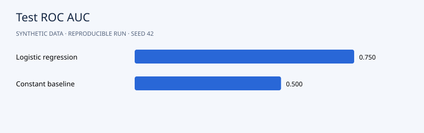

# Customer Churn and Retention Decisions

**Portfolio demonstration · synthetic data · Python 3.12 · NumPy + pandas**



## Question

Which subscription customers are at risk next month, and how should an illustrative contact budget affect the decision threshold?

## Approach

Simulate 5,000 accounts; use a seeded 60/20/20 train/validation/test split. Standardize using training statistics only. Fit L2 logistic regression directly in NumPy, select a cost-based threshold on validation data, and evaluate once on the test set against a constant-probability baseline.

The algorithms are implemented directly in NumPy so the mechanics are inspectable. Seeds default to 42. Slight numeric differences across operating systems are possible.

## Run

```bash
python -m venv .venv
source .venv/bin/activate
# Windows PowerShell: .venv\Scripts\Activate.ps1
python -m pip install -r requirements.txt
python src/main.py
python -m unittest discover -s tests -v
```

Run from the repository root. After dependency installation, the pipeline works offline and needs no credentials. It regenerates CSV inputs and reports. Checked-in reports are from an actual verified run.

## Results

The model reaches test ROC AUC **0.750** versus **0.500** for the constant baseline. At the validation-selected 0.10 threshold, recall is **91.8%** and precision **27.2%**. The assumed cost is **6.984 per account**, versus **8.000** for contacting everyone and **13.140** for contacting nobody. Accuracy is low because the policy prioritizes avoiding missed churn. These are simulated costs, not measured savings.

Read the [generated analysis](reports/report.md) and [machine-readable metrics](reports/metrics.json). Detailed predictions or diagnostics are in `reports/`. The chart above uses the same run's measurements.

## Data and provenance

`customer_id`: identifier; `tenure_months`, `monthly_fee`, `support_calls`, `usage_hours`: predictors available at scoring time; `churn`: simulated next-month cancellation (0/1).

All records are generated by `generate()` in `src/main.py`. There are no real customers, external downloads or fabricated client engagements. Code and synthetic data use the included MIT license. To analyze real data, replace the generator with a loader preserving the schema and revisit the validation design.

## Files

```text
src/main.py          generator, model and evaluation
src/common.py        numeric and reporting helpers
data/                generated CSV inputs
reports/             measured results, vector chart and detailed exports
tests/               algorithm and evaluation checks
.github/workflows/   GitHub Actions reproduction check
```

## Limitations and next steps

The synthetic outcome mechanism favors logistic regression. Costs are illustrative assumptions. Risk scores do not estimate the causal effect of a retention contact. Real use requires temporal validation, calibration checks, subgroup evaluation and a randomized retention pilot.

Before presenting this in your portfolio, run it, understand the assumptions and add your own experiment. Useful extensions include comparison with a standard library and an appropriately licensed real dataset. Describe it accurately as a synthetic-data demonstration built with AI assistance, and add your personal contributions. Avoid claims of real clients or achieved business impact.

## Discussion prompts

- Why does this evaluation answer the question?
- Which assumption is most likely to fail on real data?
- What changes when you modify a modeling choice?
- What additional evidence would justify a business decision?

## License

MIT. See [LICENSE](LICENSE).
