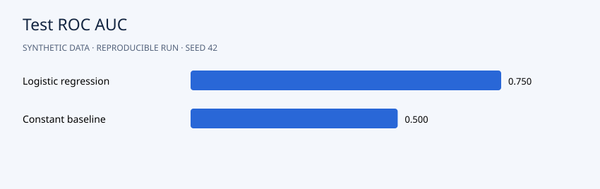

# Results

The model reaches test ROC AUC **0.750** versus **0.500** for the constant baseline. At the validation-selected 0.10 threshold, recall is **91.8%** and precision **27.2%**. The assumed cost is **6.984 per account**, versus **8.000** for contacting everyone and **13.140** for contacting nobody. Accuracy is low because the policy prioritizes avoiding missed churn. These are simulated costs, not measured savings.

## Interpretation

The threshold uses validation labels only. Compare discrimination, Brier score and the assumed decision costs; none of these measures demonstrates retention impact.



```json
{
  "split_sizes": {
    "train": 3000,
    "validation": 1000,
    "test": 1000
  },
  "validation_selected_threshold": 0.1,
  "model": {
    "roc_auc": 0.7497646735539848,
    "precision": 0.27235772357723576,
    "recall": 0.9178082191780822,
    "accuracy": 0.445,
    "brier_score": 0.14803694496645525,
    "confusion_matrix": {
      "tp": 201,
      "fp": 537,
      "fn": 18,
      "tn": 244
    }
  },
  "baseline": {
    "roc_auc": 0.5,
    "precision": 0.0,
    "recall": 0.0,
    "accuracy": 0.781,
    "brier_score": 0.17132800000000004,
    "confusion_matrix": {
      "tp": 0,
      "fp": 0,
      "fn": 219,
      "tn": 781
    }
  },
  "test_cost_per_account": 6.984,
  "contact_none_cost": 13.14,
  "contact_all_cost": 8.0
}
```

## Suggested experiment

Try a different contact cost. Select a new threshold on validation data and compare test decision costs without changing the test set.
