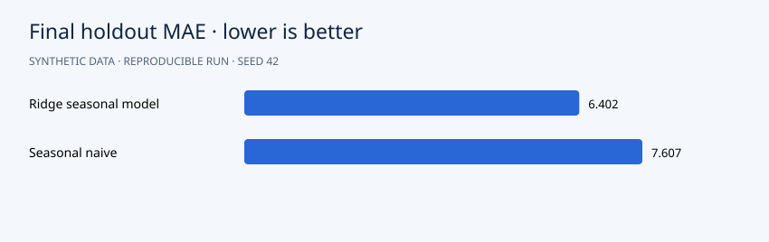

# Daily Demand Forecasting with Rolling Backtests

**Portfolio demonstration · synthetic data · Python 3.12 · NumPy + pandas**



## Question

Can a model of trend, seasonality and past demand beat a seasonal-naive sales forecast?

## Approach

Simulate three years of daily sales. Use expanding-window seven-day backtests at six historical cutoffs and reserve the final 28 days for evaluation. Fit ridge regression on time, weekly/yearly Fourier features and 1/7-day lags. Forecast recursively, so true future observations never enter lag features. Export forecasts and residuals.

The algorithms are implemented directly in NumPy so the mechanics are inspectable. Seeds default to 42. Slight numeric differences across operating systems are possible.

## Run

```bash
python -m venv .venv
source .venv/bin/activate
# Windows PowerShell: .venv\Scripts\Activate.ps1
python -m pip install -r requirements.txt
python src/main.py
python -m unittest discover -s tests -v
```

Run from the repository root. After dependency installation, the pipeline works offline and needs no credentials. It regenerates CSV inputs and reports. Checked-in reports are from an actual verified run.

## Results

Final 28-day MAE is **6.402 units** for ridge versus **7.607** for seasonal naive, a **15.8%** reduction on this holdout. The model wins four of six historical backtests and loses two. A single aggregate win therefore does not imply uniform superiority.

Read the [generated analysis](reports/report.md) and [machine-readable metrics](reports/metrics.json). Detailed predictions or diagnostics are in `reports/`. The chart above uses the same run's measurements.

## Data and provenance

`date`: daily timestamp; `units`: fictional observed unit sales. Forecast exports contain actual sales, predictions, baseline and residuals.

All records are generated by `generate()` in `src/main.py`. There are no real customers, external downloads or fabricated client engagements. Code and synthetic data use the included MIT license. To analyze real data, replace the generator with a loader preserving the schema and revisit the validation design.

## Files

```text
src/main.py          generator, model and evaluation
src/common.py        numeric and reporting helpers
data/                generated CSV inputs
reports/             measured results, vector chart and detailed exports
tests/               algorithm and evaluation checks
.github/workflows/   GitHub Actions reproduction check
```

## Limitations and next steps

Simulated seasonality is stable; promotions, stockouts and regime changes are absent. Ridge strength is fixed in advance. There are no calibrated prediction intervals; real deployment requires these and stress tests.

Before presenting this in your portfolio, run it, understand the assumptions and add your own experiment. Useful extensions include comparison with a standard library and an appropriately licensed real dataset. Describe it accurately as a synthetic-data demonstration built with AI assistance, and add your personal contributions. Avoid claims of real clients or achieved business impact.

## Discussion prompts

- Why does this evaluation answer the question?
- Which assumption is most likely to fail on real data?
- What changes when you modify a modeling choice?
- What additional evidence would justify a business decision?

## License

MIT. See [LICENSE](LICENSE).
