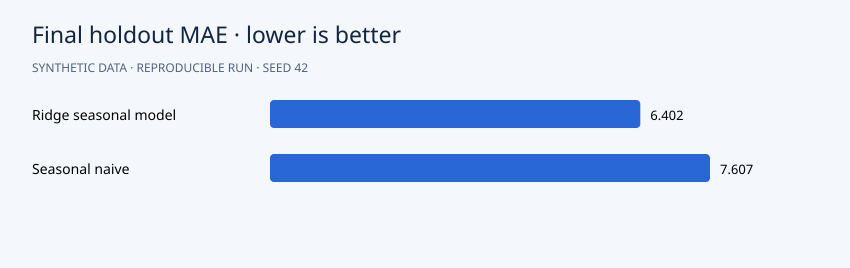

# Results

Final 28-day MAE is **6.402 units** for ridge versus **7.607** for seasonal naive, a **15.8%** reduction on this holdout. The model wins four of six historical backtests and loses two. A single aggregate win therefore does not imply uniform superiority.

## Interpretation

Six historical rolling backtests precede a final 28-day holdout. Both models recursively forecast without observing actual future demand.



```json
{
  "rolling_backtests": [
    {
      "cutoff": 700,
      "model_mae": 6.550336982360632,
      "baseline_mae": 12.285714285714286
    },
    {
      "cutoff": 756,
      "model_mae": 7.357667008888582,
      "baseline_mae": 7.285714285714286
    },
    {
      "cutoff": 812,
      "model_mae": 3.4771157588154438,
      "baseline_mae": 5.571428571428571
    },
    {
      "cutoff": 868,
      "model_mae": 5.7720052737320815,
      "baseline_mae": 5.714285714285714
    },
    {
      "cutoff": 924,
      "model_mae": 3.685642074293883,
      "baseline_mae": 6.714285714285714
    },
    {
      "cutoff": 980,
      "model_mae": 7.301096602722465,
      "baseline_mae": 9.0
    }
  ],
  "final_holdout": {
    "mae": 6.40167510528413,
    "rmse": 8.609828264164207,
    "wape": 0.027047970868863083
  },
  "seasonal_naive": {
    "mae": 7.607142857142857,
    "rmse": 9.198214112377624,
    "wape": 0.03214124038026256
  }
}
```

## Suggested experiment

Increase noise or introduce a structural break in the generator. Re-run all historical backtests before interpreting the final holdout.
