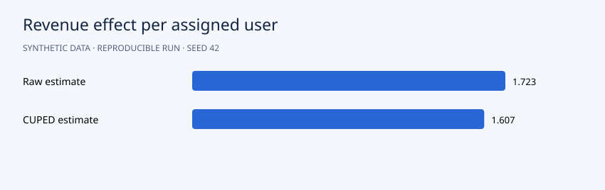

# Randomized Experiment Analysis with CUPED

**Portfolio demonstration · synthetic data · Python 3.12 · NumPy + pandas**



## Question

Does a fictional checkout treatment change revenue per assigned user, and can pre-experiment data improve precision?

## Approach

Simulate 6,000 independently randomized users. Analyze all assigned users, including zero-revenue users. Check sample allocation with an exact binomial calculation; estimate raw and CUPED-adjusted effects with 2,000 within-arm bootstrap resamples, re-estimating CUPED each time. Test the raw sharp null with 2,000 permutations. Export bootstrap draws.

The algorithms are implemented directly in NumPy so the mechanics are inspectable. Seeds default to 42. Slight numeric differences across operating systems are possible.

## Run

```bash
python -m venv .venv
source .venv/bin/activate
# Windows PowerShell: .venv\Scripts\Activate.ps1
python -m pip install -r requirements.txt
python src/main.py
python -m unittest discover -s tests -v
```

Run from the repository root. After dependency installation, the pipeline works offline and needs no credentials. It regenerates CSV inputs and reports. Checked-in reports are from an actual verified run.

## Results

The raw revenue effect is **+1.723** per assigned user with bootstrap 95% interval **[0.799, 2.597]**. CUPED estimates **+1.607**, interval **[0.994, 2.149]**, and reduces bootstrap effect-estimate variance by **57.1%**. The sample-ratio p-value is **0.230**. The simulated experiment supports a positive effect under its assumptions; it says nothing about a real checkout.

Read the [generated analysis](reports/report.md) and [machine-readable metrics](reports/metrics.json). Detailed predictions or diagnostics are in `reports/`. The chart above uses the same run's measurements.

## Data and provenance

`user_id`; `treatment`: randomized 0/1 assignment; `pre_spend`: pre-experiment covariate; `revenue`: post-assignment outcome including zeros.

All records are generated by `generate()` in `src/main.py`. There are no real customers, external downloads or fabricated client engagements. Code and synthetic data use the included MIT license. To analyze real data, replace the generator with a loader preserving the schema and revisit the validation design.

## Files

```text
src/main.py          generator, model and evaluation
src/common.py        numeric and reporting helpers
data/                generated CSV inputs
reports/             measured results, vector chart and detailed exports
tests/               algorithm and evaluation checks
.github/workflows/   GitHub Actions reproduction check
```

## Limitations and next steps

Independent users, no interference and a fixed sample size are assumed. This analysis has one pre-specified outcome; repeated peeking invalidates the fixed-horizon inference. Simulated revenue effects do not establish impact on any real product.

Before presenting this in your portfolio, run it, understand the assumptions and add your own experiment. Useful extensions include comparison with a standard library and an appropriately licensed real dataset. Describe it accurately as a synthetic-data demonstration built with AI assistance, and add your personal contributions. Avoid claims of real clients or achieved business impact.

## Discussion prompts

- Why does this evaluation answer the question?
- Which assumption is most likely to fail on real data?
- What changes when you modify a modeling choice?
- What additional evidence would justify a business decision?

## License

MIT. See [LICENSE](LICENSE).
