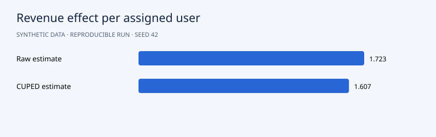

# Results

The raw revenue effect is **+1.723** per assigned user with bootstrap 95% interval **[0.799, 2.597]**. CUPED estimates **+1.607**, interval **[0.994, 2.149]**, and reduces bootstrap effect-estimate variance by **57.1%**. The sample-ratio p-value is **0.230**. The simulated experiment supports a positive effect under its assumptions; it says nothing about a real checkout.

## Interpretation

Interpret effect sizes with their confidence intervals. Clipping revenue at zero means the population effect differs slightly from the latent additive effect of 2. This is a simulated experiment, with no real rollout recommendation.



```json
{
  "n_users": 6000,
  "treatment_users": 2953,
  "sample_ratio_exact_p": 0.2298939060181867,
  "raw_revenue_effect": 1.722907903766398,
  "raw_95pct_ci": [
    0.7986541520644331,
    2.596962578538105
  ],
  "cuped_revenue_effect": 1.6066668208383454,
  "cuped_95pct_ci": [
    0.9942209693238451,
    2.1490770534371664
  ],
  "cuped_theta": 0.63488231251788,
  "bootstrap_variance_reduction": 0.5705935729654759,
  "raw_permutation_p": 0.0004997501249375312,
  "simulation_latent_additive_effect": 2.0
}
```

## Suggested experiment

Set the latent treatment effect to zero, rerun across multiple random seeds, and examine false-positive behavior without repeatedly peeking at the same experiment.
