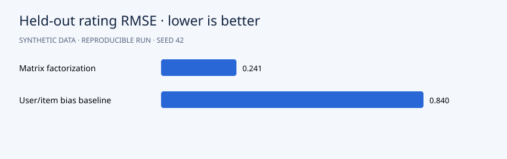

# Personalized Recommendations with Matrix Factorization

**Portfolio demonstration · synthetic data · Python 3.12 · NumPy + pandas**



## Question

Can latent user and item preferences reconstruct unseen ratings better than user/item bias alone?

## Approach

Generate 180 users, 120 products and sparse explicit ratings. Hold out four validation and four test ratings per user. Train regularized biased matrix factorization with stochastic gradient descent, selecting the epoch by validation RMSE. Compare with a trained user/item bias baseline. Export top-five recommendations excluding training and validation items.

The algorithms are implemented directly in NumPy so the mechanics are inspectable. Seeds default to 42. Slight numeric differences across operating systems are possible.

## Run

```bash
python -m venv .venv
source .venv/bin/activate
# Windows PowerShell: .venv\Scripts\Activate.ps1
python -m pip install -r requirements.txt
python src/main.py
python -m unittest discover -s tests -v
```

Run from the repository root. After dependency installation, the pipeline works offline and needs no credentials. It regenerates CSV inputs and reports. Checked-in reports are from an actual verified run.

## Results

Held-out RMSE is **0.241** for matrix factorization versus **0.840** for the user/item bias baseline. MAE is **0.185** versus **0.643**. Validation selects epoch **63**. The generator itself has four latent dimensions, so this comparison intentionally illustrates a favorable setting for matrix factorization; it is not a general performance claim.

Read the [generated analysis](reports/report.md) and [machine-readable metrics](reports/metrics.json). Detailed predictions or diagnostics are in `reports/`. The chart above uses the same run's measurements.

## Data and provenance

`user_id`, `item_id`: zero-based identifiers; `rating`: explicit score from 1 to 5. Item metadata includes fictional `name` and `category`, used only for display.

All records are generated by `generate()` in `src/main.py`. There are no real customers, external downloads or fabricated client engagements. Code and synthetic data use the included MIT license. To analyze real data, replace the generator with a loader preserving the schema and revisit the validation design.

## Files

```text
src/main.py          generator, model and evaluation
src/common.py        numeric and reporting helpers
data/                generated CSV inputs
reports/             measured results, vector chart and detailed exports
tests/               algorithm and evaluation checks
.github/workflows/   GitHub Actions reproduction check
```

## Limitations and next steps

Random rating holdouts measure preference reconstruction, not online business performance or ranking quality. Exposure is uniformly simulated; cold-start users/items are unsupported. Real deployment needs temporal splits, ranking metrics and evaluation of exposure bias.

Before presenting this in your portfolio, run it, understand the assumptions and add your own experiment. Useful extensions include comparison with a standard library and an appropriately licensed real dataset. Describe it accurately as a synthetic-data demonstration built with AI assistance, and add your personal contributions. Avoid claims of real clients or achieved business impact.

## Discussion prompts

- Why does this evaluation answer the question?
- Which assumption is most likely to fail on real data?
- What changes when you modify a modeling choice?
- What additional evidence would justify a business decision?

## License

MIT. See [LICENSE](LICENSE).
