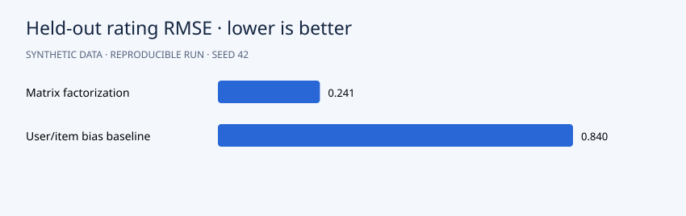

# Results

Held-out RMSE is **0.241** for matrix factorization versus **0.840** for the user/item bias baseline. MAE is **0.185** versus **0.643**. Validation selects epoch **63**. The generator itself has four latent dimensions, so this comparison intentionally illustrates a favorable setting for matrix factorization; it is not a general performance claim.

## Interpretation

Validation selects the training epoch; test ratings are used only for evaluation. Recommendations exclude training and validation items and can include held-out test items. Rating RMSE does not measure ranking performance.



```json
{
  "ratings": 7560,
  "train": 6120,
  "validation": 720,
  "test": 720,
  "selected_epoch": 63,
  "baseline_selected_epoch": 1,
  "matrix_factorization": {
    "rmse": 0.2412453743611459,
    "mae": 0.185309842602173
  },
  "bias_baseline": {
    "rmse": 0.8396464095717556,
    "mae": 0.6426708485690631
  }
}
```

## Suggested experiment

Vary the latent rank and select it using validation ratings only. Record ranking metrics separately from rating reconstruction error.
