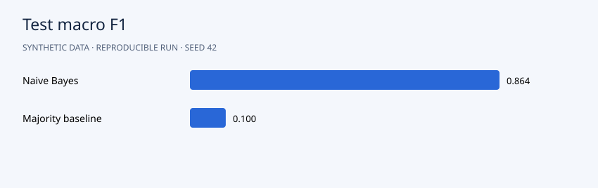

# Explainable Support Ticket Routing

**Portfolio demonstration · synthetic data · Python 3.12 · NumPy + pandas**



## Question

Can text classification route requests to four support queues, and when should the model abstain?

## Approach

Generate billing, account, technical and delivery messages; 30% intentionally contain a second intent. The label is the first (primary) request. Keep full phrase families separated across train, validation and test. Fit training-only vocabulary and multinomial Naive Bayes. Choose a routing confidence threshold on validation data with a 90% accepted-accuracy target and at least 25% coverage; abstain on everything if no threshold qualifies. Report macro F1, confusion matrix, accepted accuracy and coverage, with a majority-class baseline.

The algorithms are implemented directly in NumPy so the mechanics are inspectable. Seeds default to 42. Slight numeric differences across operating systems are possible.

## Run

```bash
python -m venv .venv
source .venv/bin/activate
# Windows PowerShell: .venv\Scripts\Activate.ps1
python -m pip install -r requirements.txt
python src/main.py
python -m unittest discover -s tests -v
```

Run from the repository root. After dependency installation, the pipeline works offline and needs no credentials. It regenerates CSV inputs and reports. Checked-in reports are from an actual verified run.

## Results

Test macro F1 is **0.864** versus **0.100** for the majority baseline. The validation-selected threshold **0.764** routes **88.9%** of test tickets with **91.2%** accepted accuracy. Single-intent accuracy is **100%**, but mixed-intent accuracy is only **55.8%**. This exposes the order information lost by bag-of-words features and motivates human review for ambiguous requests.

Read the [generated analysis](reports/report.md) and [machine-readable metrics](reports/metrics.json). Detailed predictions or diagnostics are in `reports/`. The chart above uses the same run's measurements.

## Data and provenance

`text`: fictional request; `label`: intended queue; `family`: template-family identifier; `split`: fixed train/validation/test assignment; `mixed_intent`: whether a secondary request was added. Reference numbers are fictional.

All records are generated by `generate()` in `src/main.py`. There are no real customers, external downloads or fabricated client engagements. Code and synthetic data use the included MIT license. To analyze real data, replace the generator with a loader preserving the schema and revisit the validation design.

## Files

```text
src/main.py          generator, model and evaluation
src/common.py        numeric and reporting helpers
data/                generated CSV inputs
reports/             measured results, vector chart and detailed exports
tests/               algorithm and evaluation checks
.github/workflows/   GitHub Actions reproduction check
```

## Limitations and next steps

Templates lack real linguistic diversity; shared vocabulary remains intentional despite family separation. Bag-of-words features discard order and can confuse primary and secondary requests. Secondary requests use the same family index and split as the primary request, preserving the family holdout. Confidence is uncalibrated and validation targets are not test guarantees. Repeated template variants are not independent real-world language samples. No multilingual or deployment performance claim is made.

Before presenting this in your portfolio, run it, understand the assumptions and add your own experiment. Useful extensions include comparison with a standard library and an appropriately licensed real dataset. Describe it accurately as a synthetic-data demonstration built with AI assistance, and add your personal contributions. Avoid claims of real clients or achieved business impact.

## Discussion prompts

- Why does this evaluation answer the question?
- Which assumption is most likely to fail on real data?
- What changes when you modify a modeling choice?
- What additional evidence would justify a business decision?

## License

MIT. See [LICENSE](LICENSE).
