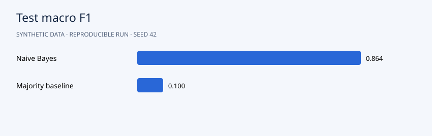

# Results

Test macro F1 is **0.864** versus **0.100** for the majority baseline. The validation-selected threshold **0.764** routes **88.9%** of test tickets with **91.2%** accepted accuracy. Single-intent accuracy is **100%**, but mixed-intent accuracy is only **55.8%**. This exposes the order information lost by bag-of-words features and motivates human review for ambiguous requests.

## Interpretation

Full phrase families are reserved for validation and test. Inspect confusion, accepted coverage and the stated language limitations before considering automated routing.



```json
{
  "model": {
    "accuracy": 0.8642857142857143,
    "macro_f1": 0.8636786627887159,
    "class_order": [
      "account",
      "billing",
      "delivery",
      "technical"
    ],
    "confusion_matrix": [
      [
        69,
        1,
        0,
        0
      ],
      [
        5,
        56,
        6,
        3
      ],
      [
        5,
        2,
        63,
        0
      ],
      [
        5,
        0,
        11,
        54
      ]
    ]
  },
  "majority_baseline": {
    "accuracy": 0.25,
    "macro_f1": 0.1,
    "class_order": [
      "account",
      "billing",
      "delivery",
      "technical"
    ],
    "confusion_matrix": [
      [
        70,
        0,
        0,
        0
      ],
      [
        70,
        0,
        0,
        0
      ],
      [
        70,
        0,
        0,
        0
      ],
      [
        70,
        0,
        0,
        0
      ]
    ]
  },
  "validation_selected_threshold": 0.7644646464646464,
  "test_routing_coverage": 0.8892857142857142,
  "test_accepted_accuracy": 0.9116465863453815,
  "mixed_intent_test_accuracy": 0.5581395348837209,
  "single_intent_test_accuracy": 1.0,
  "vocabulary_size": 77,
  "split_sizes": {
    "train": 1120,
    "validation": 280,
    "test": 280
  }
}
```

## Suggested experiment

Compare a model that preserves word order or routes multi-intent requests to a review queue. Select any routing threshold on validation data, not test outcomes.
