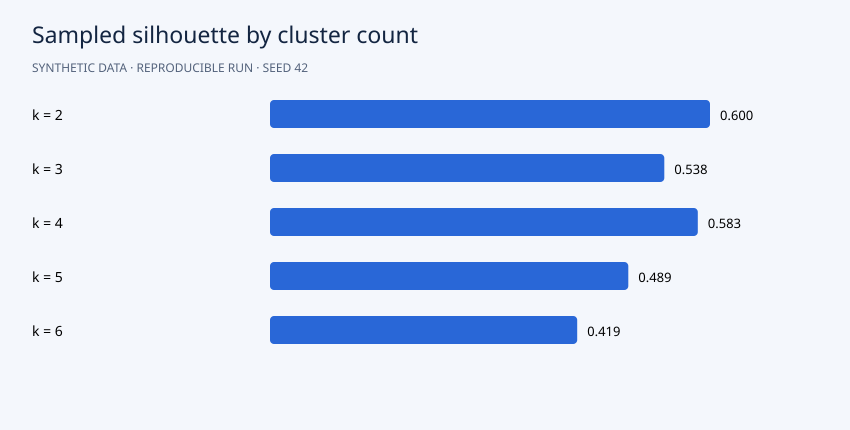

# Customer Segmentation and Stability Analysis

**Portfolio demonstration · synthetic data · Python 3.12 · NumPy + pandas**



## Question

Which groups emerge from recency, frequency and monetary behavior, and do the groups survive resampling?

## Approach

Simulate 1,200 customers with RFM behavior. Log-transform and standardize, then run multi-start k-means for k=2 through 6. Select k by silhouette on a fixed sample of 400 customers. Compare full-data assignments against eight bootstrap fits using permutation-invariant adjusted Rand index. Export original-unit cluster profiles and assignments.

The algorithms are implemented directly in NumPy so the mechanics are inspectable. Seeds default to 42. Slight numeric differences across operating systems are possible.

## Run

```bash
python -m venv .venv
source .venv/bin/activate
# Windows PowerShell: .venv\Scripts\Activate.ps1
python -m pip install -r requirements.txt
python src/main.py
python -m unittest discover -s tests -v
```

Run from the repository root. After dependency installation, the pipeline works offline and needs no credentials. It regenerates CSV inputs and reports. Checked-in reports are from an actual verified run.

## Results

Silhouette selects **k=2**, score **0.600**, with clusters of **858** and **342** customers. Mean bootstrap adjusted Rand index is **0.988**, indicating stable coarse assignments in this simulation. The generator contains four latent groups, yet silhouette prefers two: a reminder that geometric separation can favor broad groups over the intended business granularity.

Read the [generated analysis](reports/report.md) and [machine-readable metrics](reports/metrics.json). Detailed predictions or diagnostics are in `reports/`. The chart above uses the same run's measurements.

## Data and provenance

`customer_id`; `recency_days`: days since last purchase; `orders_90d`: recent orders; `spend_90d`: recent fictional spend. Hidden generator segment labels are never supplied to clustering or selection.

All records are generated by `generate()` in `src/main.py`. There are no real customers, external downloads or fabricated client engagements. Code and synthetic data use the included MIT license. To analyze real data, replace the generator with a loader preserving the schema and revisit the validation design.

## Files

```text
src/main.py          generator, model and evaluation
src/common.py        numeric and reporting helpers
data/                generated CSV inputs
reports/             measured results, vector chart and detailed exports
tests/               algorithm and evaluation checks
.github/workflows/   GitHub Actions reproduction check
```

## Limitations and next steps

This is exploratory analysis of the whole dataset, not predictive holdout performance. Spherical and separated synthetic groups favor k-means. Bootstrap fits reuse the original feature scaling. Stability does not prove commercial actionability; real use needs business validation.

Before presenting this in your portfolio, run it, understand the assumptions and add your own experiment. Useful extensions include comparison with a standard library and an appropriately licensed real dataset. Describe it accurately as a synthetic-data demonstration built with AI assistance, and add your personal contributions. Avoid claims of real clients or achieved business impact.

## Discussion prompts

- Why does this evaluation answer the question?
- Which assumption is most likely to fail on real data?
- What changes when you modify a modeling choice?
- What additional evidence would justify a business decision?

## License

MIT. See [LICENSE](LICENSE).
