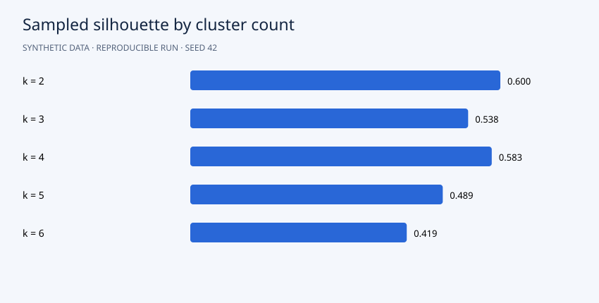

# Results

Silhouette selects **k=2**, score **0.600**, with clusters of **858** and **342** customers. Mean bootstrap adjusted Rand index is **0.988**, indicating stable coarse assignments in this simulation. The generator contains four latent groups, yet silhouette prefers two: a reminder that geometric separation can favor broad groups over the intended business granularity.

## Interpretation

Assess both separation and resampling stability. Cluster identifiers are arbitrary; use the original-unit median profiles to interpret their behavior before proposing campaigns.



```json
{
  "selected_k": 2,
  "candidates": [
    {
      "k": 2,
      "silhouette": 0.6000820645589284,
      "inertia": 1211.4177659027123
    },
    {
      "k": 3,
      "silhouette": 0.5377688063428024,
      "inertia": 594.7205561256004
    },
    {
      "k": 4,
      "silhouette": 0.5833772401928534,
      "inertia": 323.8457932033116
    },
    {
      "k": 5,
      "silhouette": 0.4887082277577017,
      "inertia": 287.51017658775226
    },
    {
      "k": 6,
      "silhouette": 0.418995238813894,
      "inertia": 264.6604625080141
    }
  ],
  "bootstrap_ari": [
    0.9862176118689286,
    0.9965505109205085,
    0.9965505109205085,
    0.9690758583280551,
    0.9588364261961458,
    0.9965505109205085,
    1.0,
    0.9965505109205085
  ],
  "mean_bootstrap_ari": 0.9875414925093955,
  "cluster_sizes": {
    "0": 858,
    "1": 342
  }
}
```

## Suggested experiment

Compare k=2 and k=4 profiles and decide which granularity is operationally useful. Do not choose a segment count solely to match the generator.
